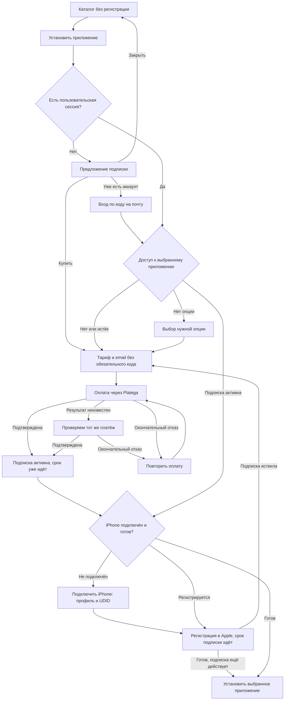

# Покупка подписки и подключение iPhone

Дата: 2026-11-06. Статус: утверждено владельцем 2026-11-06. Реализация ещё не выполнена.

Главная спецификация: [Xstore](2026-11-02-xstore-design.md). Задачи реализации находятся в существующих планах [M2](../plans/2026-11-05-m2-auth-cabinet.md), [M3](../plans/2026-11-05-m3-apple-pool.md), [M4](../plans/2026-11-05-m4-signing-install.md) и [M5](../plans/2026-11-05-m5-billing.md). Одна веха — один план; три сценария отдельно проверяются в M5, задачи 7–9.

## 1. Цель и выбранный подход

Человек сначала изучает приложения. При попытке установки без подходящего доступа видит предложение подписки. Первая оплата не требует отдельной регистрации, кода из письма или получения UDID.

**Последнее уточнение владельца: подписка активируется сразу после подтверждения оплаты. Срок идёт с этого момента независимо от того, когда человек подключит iPhone и когда Apple закончит регистрацию.** Это заменяет обсуждавшийся ранее вариант начала срока после готовности устройства.

| Подход | Последствия | Решение |
|---|---|---|
| Вход, UDID, затем оплата | Почта и настройки iOS прерывают покупку | Заменён |
| Оплата, активная подписка, затем подключение iPhone | Короткий путь до оплаты, доступ сохраняется в аккаунте до привязки | Выбран владельцем |
| Начало срока только после готовности Apple | Оплаченный период ждёт устройства | Отменён последним уточнением владельца |

Сохраняются Platega, одна подписка для одного устройства, профиль для получения UDID и обязательный пароль + TOTP для сотрудников. Установка приложения требует подключённого и готового устройства; активность подписки от этого не зависит. Автоматические повторные списания это изменение не вводит.

## 2. Сценарий 1: впервые на сайте

1. Каталог, поиск, карточки и тарифы доступны без аккаунта. На доступном приложении — «Установить».
2. Нажатие открывает «Для установки приложений нужна подписка»: «Выбрать подписку», «Уже есть аккаунт? Войти» и закрытие без потери страницы/прокрутки.
3. Выбор тарифа сохраняет исходное приложение. Для `addon:<code>` предложение включает нужную опцию; базовая подписка не обещает доступ ко всем приложениям.
4. Человек указывает email и видит сумму, период, одно устройство, условия и текст: «Подписка начнётся после оплаты. Для установки потребуется подключить iPhone. Регистрация устройства в Apple может занять до 72 часов». Нажимает «Оплатить … ₽». Обязательного подтверждения email до оплаты нет.
5. При начале оплаты сервис автоматически создаёт отдельный аккаунт покупки и заказ; браузер получает сессию именно этого аккаунта. Введённая почта — контакт покупки, а не доказательство владения существующим аккаунтом.
6. После подтверждения провайдером — «Подписка активна до …» и основная кнопка «Подключить iPhone». Доступ и даты уже видны в аккаунте; ожидание подключения не останавливает срок.
7. В Safari на iPhone кнопка открывает инструкцию и профиль. После установки профиль возвращает UDID; устройство привязывается к аккаунту и подписке. В деталях показываем модель и сокращённый UDID.
8. Пока Apple регистрирует устройство, показываем «Подписка активна. Устройство регистрируется» и ожидаемый срок. Когда готово — «Установить <название приложения>»; установка запускается явным нажатием.

## 3. Сценарий 2: аккаунт есть, подписки нет

1. Сохранившаяся сессия пропускает вход. Иначе «Войти» → код на почту → возврат к приложению/заказу.
2. «Установить» → предложение подходящего тарифа. Истёкшая подписка → «Продлить подписку».
3. Для известного устройства используем связанную подписку. При нескольких устройствах нужен выбор; для нового — «Новый iPhone». Отсутствие `currentDeviceId` не означает отсутствие подписок.
4. Оплата использует текущий аккаунт. Повторный email при подтверждённой почте и повторный профиль уже подключённого iPhone не требуются.
5. После подтверждения подписка активна сразу. Готовый iPhone позволяет установить исходное приложение. Для нового iPhone — «Подключить iPhone»; для регистрируемого — статус Apple, без повторного предложения оплатить.

## 4. Сценарий 3: аккаунт и подписка есть

1. Используем сессию или предлагаем вход с возвратом к приложению.
2. Подходящая активная подписка и готовый выбранный iPhone → «Установить» сразу запускает подпись/установку, без тарифов и оплаты.
3. Активная подписка без устройства → «Подключить iPhone». Устройство регистрируется → «Подписка активна. Устройство регистрируется». Обе ветки сохраняют исходные даты и не предлагают купить ту же подписку повторно.
4. Подписка на другой iPhone не открывает доступ текущему. Нужно выбрать своё устройство или купить отдельную подписку для нового.
5. Нет только опции приложения → предлагаем эту опцию без повторной покупки базовой подписки.
6. Подписка истекла до подключения или во время ожидания Apple → показываем дату окончания и «Продлить подписку». Это новый оплачиваемый период, а не повторная оплата того же заказа.
7. Скрытое приложение, непригодная версия или заблокированное устройство → объяснение причины; покупка не используется как исправление технической блокировки.

## 5. Схема

## 6. Состояния интерфейса

| Условие | Действие |
|---|---|
| Нет сессии | «Установить» открывает предложение подписки, вход — второе действие |
| Есть незавершённый неоплаченный заказ | «Продолжить оплату», без второго параллельного платежа |
| Платёж ещё проверяется | «Проверяем оплату», новый платёж не создаётся |
| Подписка активна, устройство не назначено | «Подключить iPhone» или выбор уже принадлежащего пользователю устройства |
| Подписка активна, Apple ещё обрабатывает устройство | Дата окончания подписки и отдельный статус регистрации |
| Подписки нет или она истекла | «Выбрать подписку» / «Продлить подписку» |
| Есть база, нет нужной опции | Предложение только этой опции |
| Подписка и устройство готовы | «Установить» → подпись → явное нажатие OTA-ссылки → инструкция |

Сначала проверяем недоступность и блокировки, затем состояние платежа, затем подходящие оплаченные права, затем готовность устройства. Активную подписку нельзя перекрывать предложением повторной покупки из-за отсутствующего UDID. Истёкшая подписка, напротив, не становится активной от подключения. Проверки выполняет API, а не только интерфейс.

## 7. Аккаунт, email и восстановление

Техническое решение исполнителя: автоматический аккаунт покупки — `User.isProvisional = true`, `email = null`, `checkoutEmail` содержит неподтверждённый контакт. Он создаётся при явном начале оплаты и получает пользовательскую сессию только на собственные данные; термин «временный аккаунт» покупателю не показывается.

- Введённый email не используется для выдачи сессии существующего пользователя. Известный и неизвестный адрес проходят одинаковый checkout без раскрытия существования аккаунта.
- Вход/восстановление с другого браузера требует кода на email: 6 цифр, 10 минут, 5 неправильных попыток; повторная отправка через 60 секунд. Код не прерывает первую оплату.
- После подтверждения email выполняется `claimProvisional` в транзакции под блокировкой нормализованной почты. В подтверждённый пользовательский аккаунт переносятся только временные покупки с совпадающим `checkoutEmail`, их подписки и устройства; id, даты оплаты и окончания сохраняются. Если подтверждённого аккаунта нет, один временный повышается до обычного. Остальные исходные аккаунты закрываются.
- Старые сессии и незавершённые enrollment отзываются до новой сессии. Hand-off проверяет исходную сессию в БД и не может её воскресить. Перенос подтверждённых аккаунтов, чужого email, заблокированных пользователей и staff запрещён. Данные подписи/загрузок переносятся только вместе с теми же собственными покупками.
- Если разные временные аккаунты содержат один UDID или иные несовместимые владельцы, транзакция отклоняется без частичного переноса; покупка сохраняется, есть поддержка. Подтверждённые аккаунты автоматически не объединяются.
- До оплаты email можно исправить. После первой подтверждённой оплаты изменение контакта требует проверки новой почты; снимок адреса заказа сохраняется для аудита.
- Письмо содержит номер заказа и `/resume?order=<id>` без секрета. Ссылка сама по себе не открывает заказ: без сессии сначала код, затем проверка владения. Потеря cookie не теряет покупку и не начинает период заново.
- Сессия: 30 дней с продлением по M2. Заказы и подписки хранятся независимо от cookie. Для существующей подтверждённой почты не создаём ещё один обычный аккаунт.

## 8. Подключение iPhone

- Вход в аккаунт — по коду на email. UDID определяет устройство, но не служит способом входа. `/connect-device` работает внутри сессии владельца; гость сначала входит с сохранением пути.
- Оплатить можно с компьютера. После оплаты — «Продолжите на iPhone» и письмо. Подписка уже активна и расходует свой период; профиль работает в Safari на iPhone/iPad.
- Один UDID принадлежит одному пользователю; одно устройство назначается одной подписке, одна подписка — одному устройству. Уже своё устройство повторно не создаётся. Чужой UDID не переносится: предлагаем войти в аккаунт устройства или обратиться в поддержку.
- Подписка может быть оплачена без устройства. Первое назначение атомарно, повтор того же запроса безопасен; переназначение к другому iPhone — только поддержка и аудит. Назначение не меняет `startsAt`/`expiresAt`.
- Ошибка профиля, истёкший nonce, смена браузера и задержка Apple не требуют новой покупки. Продолжение сохраняет заказ, подписку и исходное приложение. Уже известное своё устройство не требует повторного профиля для продления.

## 9. Модель подписки и сроки

Технические решения исполнителя для доступа, который начинается до получения UDID:

- `Subscription { id, userId, deviceId? }` представляет одну оплаченную линию доступа для одного iPhone. До назначения устройства она принадлежит аккаунту. `deviceId` уникален, допускает `null`. Несколько устройств требуют нескольких подписок; права разных подписок не суммируются для одного запроса установки.
- `Order` всегда ссылается на пользователя и подписку; `deviceId` для оплаты не требуется. Хранит `checkoutKey`, `checkoutEmail`, безопасный `returnTo` и снимок пунктов с ценами, периодами, уровнем и характеристиками. `checkoutKey` глобально уникален; блокировка ключа и проверка повтора происходят до создания гостевого аккаунта. Конкурентный запрос без сессии не создаёт второй платёж и не получает чужой заказ.
- Платёжный статус `created / pending / paid / failed / expired / refunded` отделён от выполнения `none / awaiting_device / activating / ready / canceled`. `paid` немедленно создаёт права и даты; ожидание UDID/Apple отражается только в выполнении.
- `Entitlement { subscriptionId, planId, planCode, kind, durationDays, startsAt, expiresAt, orderId?, grantedById?, revokedAt? }`. Даты обязательны с момента подтверждения оплаты. Уникальность `(orderId, planCode)` защищает от повторной выдачи.
- Первая покупка или возобновление после перерыва: `startsAt = paidAt`, `expiresAt = startsAt + durationDays` (целые сутки UTC). `paidAt` — время подтверждённой операции у провайдера, а не время позднего вебхука или обработчика.
- Продление: начало `max(paidAt, конец ранее оплаченных неотозванных периодов той же цепочки subscriptionId + kind/code)`. Будущий период продления не отменяет текущий активный доступ. Гарантия считается от начала соответствующего оплаченного периода.
- База и опции действуют по оплаченным датам независимо от устройства. Опция требует активной базы либо базового тарифа в том же заказе. Если база уже действует, новая опция начинается в `paidAt`; иначе — не раньше начала базового периода этого заказа. Подключение устройства не сдвигает ни базу, ни опции.
- `canInstall` получает права только подписки, назначенной выбранному собственному устройству; отдельно требует готовность Apple и нужную опцию. Активная подписка видна в кабинете и до назначения устройства.
- Неоплаченный заказ имеет локальный срок 24 часа, но истечение само по себе не разрешает второй платёж при неизвестном результате первого. Сначала подтверждаем окончательный статус/закрытие старого платежа у провайдера. Возвратный URL и кнопка «Назад» не являются подтверждением или отказом.
- Позднее подтверждение заказа, уже закрытого локально, вызывает сверку и алерт для поддержки; не создаём вторую подписку и не скрываем подтверждённое списание. Точные возможности отмены/идемпотентности Platega проверяются по документации мерчанта до реализации адаптера.
- Возврат отзывает права и отменяет ещё не запущенное выполнение. Если регистрация уже началась, результат Apple не возобновляет отозванный доступ. Обработка вебхуков и выдача прав атомарны и идемпотентны.
- Периодическая сверка восстанавливает пропущенное выполнение оплаченных заказов с назначенным устройством, но не меняет даты прав. Истечение подписки не удаляет регистрацию устройства и не требует повторного UDID.

## 10. Задачи и критерии проверки

| Сценарий | План реализации | Проверка |
|---|---|---|
| Первый визит | M2 задачи 1, 5–8; M5 задачи 1–5, 7 | `purchase-first-visit.spec.ts`: каталог → оплата без кода/UDID → активная подписка и даты → подключение → исходное приложение |
| Аккаунт без подписки | M5 задача 8 и общие задачи 1–6 | `purchase-existing-account.spec.ts`: покупка/продление в существующей сессии без повторного профиля |
| Аккаунт с подпиской | M4 задача 6; M5 задача 9 | `install-subscriber.spec.ts`: подходящий доступ → установка; нет UDID → подключение без повторной оплаты |

Обязательные проверки: ввод чужой почты не выдаёт чужую сессию; восстановление после потери cookie сохраняет даты; повтор вебхука не удваивает срок; оплата без устройства немедленно создаёт активные права; подключение через неделю не сдвигает период; истечение до подключения не даёт установку; два устройства не смешивают права; возврат прекращает доступ даже при поздней готовности Apple.

Критерии удобства: до первой оплаты нет обязательного перехода в почту/настройки iOS; после оплаты одно основное следующее действие; действующему подписчику не показывается платёжное окно из-за технической активации. Цена, период, одно устройство и начало срока сразу после оплаты видны до платежа. Конверсия — цель дизайна, а не заявленное улучшение без измерений.

## 11. Границы

Сейчас меняются только спецификации, существующие планы M2–M5, обзор и README. Код и миграции выполняются отдельно по этим планам. Перед production нужны документация/ключи Platega, опубликованные условия и проверка на реальном iPhone. Цены задаёт админ.
